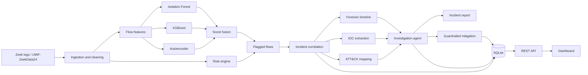

# Architecture

## Modules

| Stage | Module | Purpose |
|---|---|---|
| Ingestion | `ingestion/loader.py`, `ingestion/zeek.py` | Load dataset files and parse raw Zeek conn logs (TSV, JSON, gzip) |
| Preprocessing | `preprocessing/cleaning.py`, `preprocessing/features.py` | Standardise columns, parse time, build numeric and categorical flow features |
| Detection | `detection/` | Isolation Forest, XGBoost, autoencoder, score fusion, rule engine |
| Evaluation | `evaluation.py`, `visualization.py` | Precision, recall, F1, false positive rate, confusion matrices, ROC and PR curves |
| Correlation | `correlation/incidents.py` | Group flagged flows per source host into incidents using a time gap |
| Forensics | `forensics/timeline.py` | Timelines, activity bursts, peak rates, failed connection ratio |
| Threat intelligence | `threat_intel/iocs.py`, `threat_intel/attack_mapping.py` | IOC extraction, local blocklist check, ATT&CK technique mapping |
| Agent | `agent/` | Toolbox, adaptive planner, playbooks, report builder, narrators, guardrails |
| Storage | `storage/store.py` | SQLite tables for incidents, IOCs, agent results and the audit log |
| API | `api/app.py` | FastAPI service over the database |
| Simulation | `simulation/scenarios.py` | Lab scenarios: port scan, SSH brute force, exfiltration |

## Agent design

One agent investigates each incident. A planner chooses the next tool from what has already been found: incident summary, timeline, IOCs, blocklist check, ATT&CK context, severity. The report narrative comes from a template by default, or from an LLM when `--llm` is used, with automatic fallback to the template.

## Guardrails

- Only actions in the approved list can run: `isolate_lab_host`, `block_ioc_test_rule`, `draft_phishing_takedown_notice`
- The target must be inside the configured lab networks
- A human must confirm every action
- Execution is simulated and every executed action is written to the audit log
- Mitigation steps come only from the playbooks, never from model output
